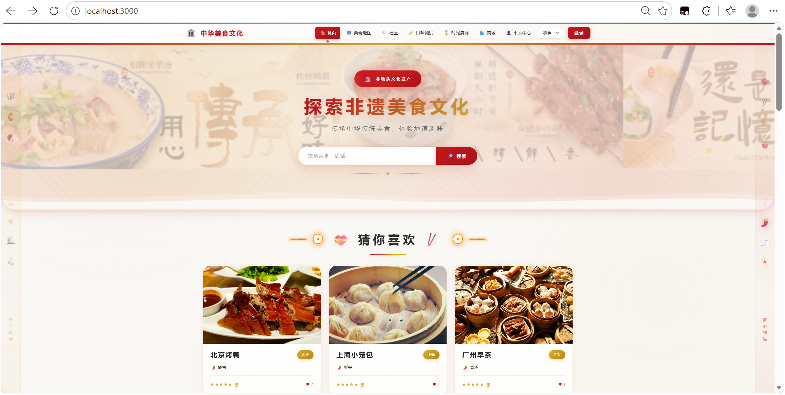
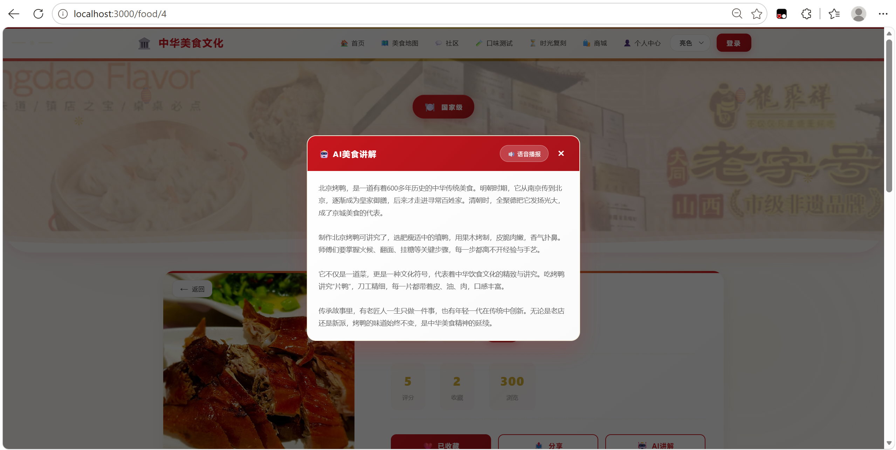
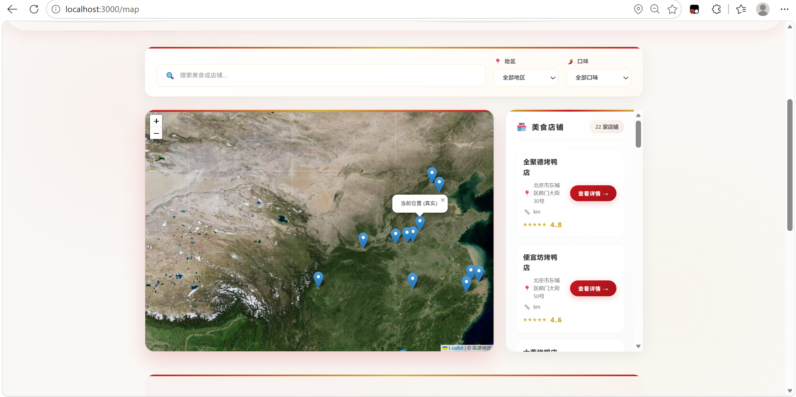
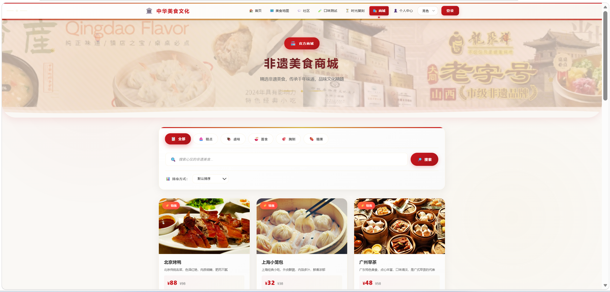
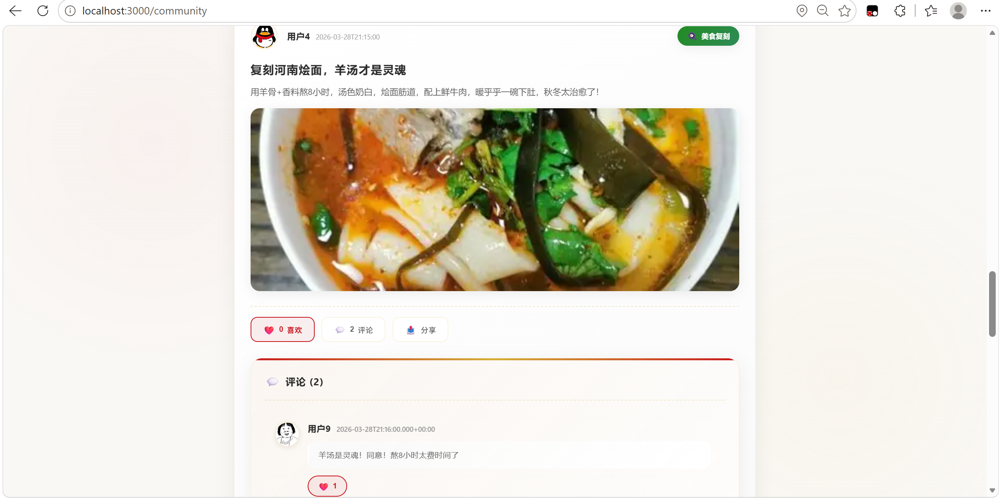
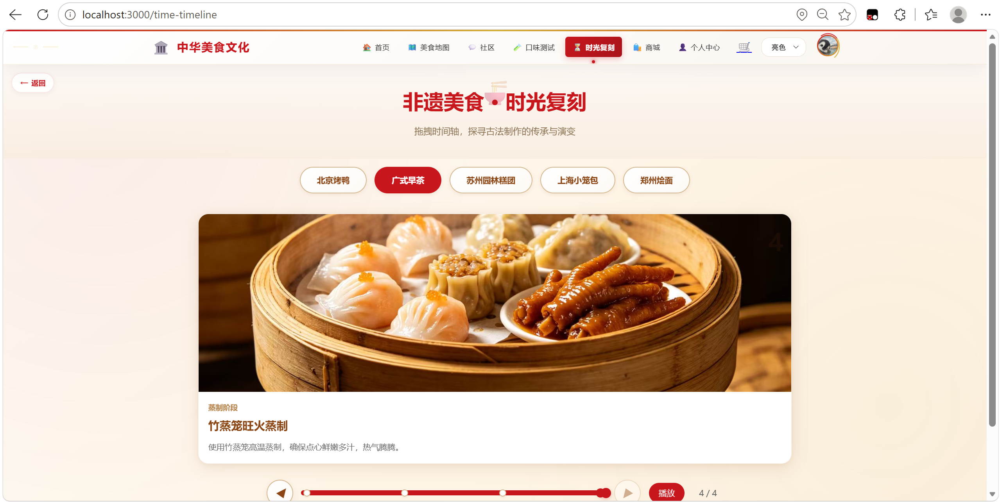
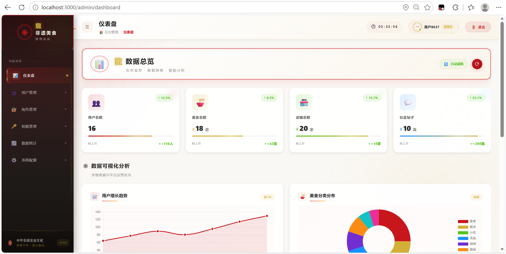
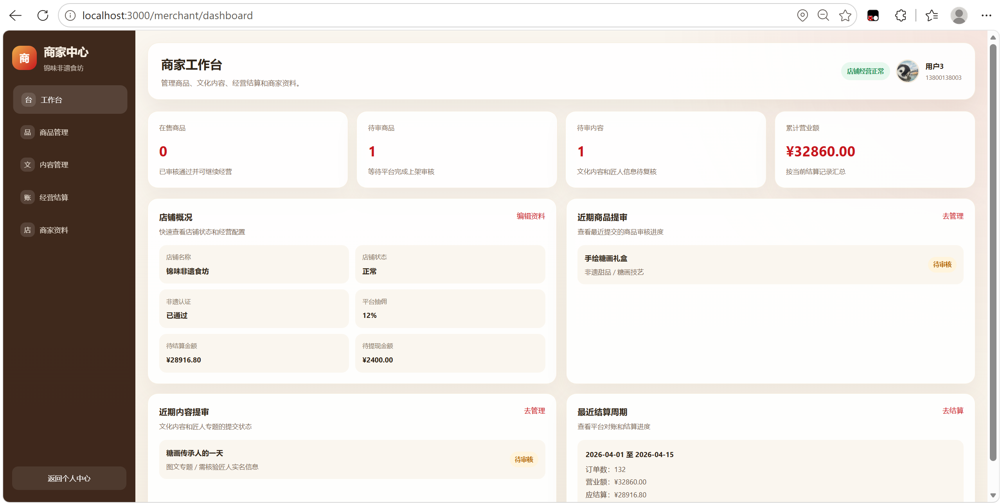

# 华韵味脉 · 非遗美食平台

> 探索中华非遗美食的综合性平台:非遗美食百科、店铺地图、社区分享、在线商城,以及商家工作台与平台管理端。
> 本项目曾参加中国大学生计算机设计大赛(作品编号 2026029142),现作为个人项目持续维护。

## ✨ 功能总览

平台分为**用户端、商家端、管理端**三部分,共 40+ 个页面:

**用户端**
- 🍜 **非遗美食百科**:美食列表/详情,按地区、口味、非遗等级筛选,评分与收藏
- 🗺️ **美食地图**:基于 Leaflet 的非遗店铺/美食点位地图,支持按地区与口味筛选
- 🏪 **店铺浏览**:店铺列表/详情,招牌菜、店铺活动、评价展示
- 💬 **社区分享**:美食帖/探店帖发布、点赞、评论(含图片上传)
- 🛍️ **非遗商城**:商品浏览/搜索/推荐、购物车、下单、模拟支付、订单管理
- 🤖 **AI 美食讲解**:详情页接入通义千问(DashScope),从起源历史、制作工艺、文化价值、传承故事四段式介绍美食
- 🧋 **口味测试**:趣味答题生成口味画像(如"江南清鲜爱好者")
- ⏳ **非遗时间轴**:非遗美食历史沿革可视化时间轴
- 🌗 **三套主题**:亮色 / 暗色 / 护眼色,支持跟随系统

**商家端**(`/merchant`)
- 入驻申请、资质认证提交
- 商品与内容的提交、平台审核状态跟踪
- 财务中心:结算单查看、提现申请
- 店铺资料维护

**管理端**(`/admin`)
- 数据看板与统计(Chart.js:用户趋势、美食品类、用户地域、活跃度),支持报表导出
- 用户管理、商家管理(入驻/资质/商品/内容/评价/匠人审核)
- 结算与提现审核、敏感词库管理
- RBAC 角色权限管理(角色、权限、授权)
- 系统参数设置

## 🖼 系统预览

|  |  |
|:---:|:---:|
| *首页 · 国风视觉与美食推荐* | *AI 美食讲解 · 通义千问四段式介绍* |

|  |  |
|:---:|:---:|
| *美食地图 · Leaflet 卫星图打点 22 家店铺* | *非遗商城 · 分类筛选与商品推荐* |

|  |  |
|:---:|:---:|
| *社区 · 美食帖/探店帖与评论互动* | *时光复刻 · 非遗美食工艺时间轴* |

|  |  |
|:---:|:---:|
| *管理端 · 数据看板与 Chart.js 可视化* | *商家端 · 经营结算与提现工作台* |

## 🛠 技术栈

| 层次 | 技术 |
|------|------|
| 前端 | Vue 3.4 + TypeScript + Vite 5 + Pinia + Vue Router 4 |
| UI/可视化 | Element Plus 2.6、Leaflet 1.9(地图)、Chart.js 4(图表)、vue-lazyload |
| 后端 | Spring Boot 2.7.15(Java 21)、Spring MVC、MyBatis-Plus 3.5.5 |
| 数据库 | MySQL 8.0(31 张表,含演示数据) |
| AI | 阿里云 DashScope(通义千问 qwen-turbo) |
| 工具 | Lombok、MapStruct、OkHttp、fastjson2 |

## 🏗 系统架构

```
┌────────────────────────────────────────────────────┐
│                浏览器(用户/商家/管理员)              │
└──────────────────────┬─────────────────────────────┘
                       │ HTTP
┌──────────────────────▼─────────────────────────────┐
│         前端 frontend                 │
│   Vue 3 + Pinia + Vue Router(开发端口 3000)         │
│   Vite Dev Server 代理 /api、/file → 后端 8088       │
└──────────────────────┬─────────────────────────────┘
                       │ REST API(JSON)
┌──────────────────────▼─────────────────────────────┐
│         后端 backend(端口 8088)       │
│  Controller(17) → Service → Mapper(MyBatis-Plus)   │
│  PermissionInterceptor(RBAC 拦截 /api/admin/**)     │
│  GlobalExceptionHandler 统一异常兜底                 │
└───────────┬──────────────────────────┬─────────────┘
            │                          │
   ┌────────▼─────────┐      ┌─────────▼──────────┐
   │  MySQL 8.0       │      │ 阿里云 DashScope    │
   │  feiyi_food_...  │      │ 通义千问(AI 讲解)   │
   │  31 张表         │      └────────────────────┘
   └──────────────────┘
```

> 仓库中的 pom 依赖里还声明了 Elasticsearch 与 Redis,当前版本未实际启用(已排除 Redis 自动配置),属于预留扩展,详见 [docs/architecture.md](docs/architecture.md)。

## 📁 项目结构

```
heritage-food-platform/
├── backend/                        # Spring Boot 后端(端口 8088)
│   └── src/main/java/com/heritage/food/
│       ├── api/                  # 17 个 REST Controller
│       ├── service/              # 业务逻辑(含 DashScope AI、商家全流程)
│       ├── dao/                  # MyBatis-Plus Mapper
│       ├── model/                # 实体类
│       ├── config/               # Security/Web/MyBatis/全局异常等配置
│       ├── interceptor/          # RBAC 权限拦截器
│       └── annotation/           # @RequirePermission 等自定义注解
├── frontend/                       # Vue 3 前端(端口 3000)
│   └── src/
│       ├── views/                # 用户端页面(27 个)
│       ├── views/merchant/       # 商家端(5 个)
│       ├── views/admin/          # 管理端(8 个)
│       ├── stores/               # Pinia 状态管理(21 个 store)
│       ├── api/                  # Axios 封装与各领域 API
│       ├── components/           # 公共组件
│       └── router/               # 路由与导航守卫
├── sql/
│   └── feiyi_food_platform.sql   # 数据库建表 + 演示数据(31 张表)
├── docs/                           # 项目文档(架构/API/数据库/部署/开发指南)
│   └── screenshots/              # 系统界面截图
└── .github/workflows/              # CI(后端编译 + 前端构建)
```

## 🚀 快速开始

### 环境要求

| 依赖 | 版本要求 |
|------|---------|
| JDK | 21+ |
| Maven | 3.6+ |
| Node.js | 18+ |
| MySQL | 8.0+ |

> Redis / Elasticsearch **无需安装**(当前版本未启用)。

### 1. 初始化数据库

```sql
CREATE DATABASE feiyi_food_platform DEFAULT CHARACTER SET utf8mb4;
```

然后导入 [sql/feiyi_food_platform.sql](sql/feiyi_food_platform.sql)(含 31 张表与演示数据,可用 Navicat 或执行 `mysql -uroot -p feiyi_food_platform < sql/feiyi_food_platform.sql`)。

### 2. 启动后端(端口 8088)

```bash
cd backend
mvn spring-boot:run
```

- 数据库连接默认 `localhost:3306`,账号密码在 `src/main/resources/application.yml` 中配置,支持通过环境变量 `MYSQL_USERNAME` / `MYSQL_PASSWORD` 覆盖
- AI 讲解功能需要在环境变量或 `application-local.yml` 中配置 DashScope API Key(见 [docs/deployment.md](docs/deployment.md)),未配置时仅 AI 讲解功能不可用,其余功能不受影响

### 3. 启动前端(端口 3000)

```bash
cd frontend
npm install
npm run dev
```

访问 http://localhost:3000(局域网内手机也可通过本机 IP 访问)。

### 4. 演示账号

登录采用手机号 + 验证码(演示版,验证码任意):

| 角色 | 手机号 | 说明 |
|------|--------|------|
| 管理员 | `13800138000` | 进入 `/admin` 管理端 |
| 商家 | `13800138003`、`13800138005` | 可进入 `/merchant` 商家工作台 |
| 普通用户 | 任意其他手机号 | 首次登录自动注册 |

> 当前版本为演示实现:登录态由前端维护,手机号即身份,详见 [已知说明](#%EF%B8%8F-已知说明与安全提示)。

## 📚 文档目录

| 文档 | 内容 |
|------|------|
| [docs/architecture.md](docs/architecture.md) | 系统架构与模块设计、关键流程说明 |
| [docs/api.md](docs/api.md) | 全部 REST API 接口清单 |
| [docs/database.md](docs/database.md) | 数据库设计(31 张表分组说明) |
| [docs/deployment.md](docs/deployment.md) | 环境搭建、配置项、打包部署、常见问题 |
| [docs/development.md](docs/development.md) | 开发约定、目录结构、后续改进计划 |
| [backend/README.md](backend/README.md) | 后端模块说明 |
| [frontend/README.md](frontend/README.md) | 前端模块说明 |

## ⚠️ 已知说明与安全提示

作为比赛演示作品,部分模块采用简化实现,使用/二次开发前请知悉:

1. **登录鉴权为演示实现**:后端无登录接口与密码校验,前端通过手机号查询/自动注册完成登录,token 由前端生成;管理员/商家身份由前端手机号规则判定。正式使用需改造为真实认证(如 JWT),见 [development.md 的改进计划](docs/development.md)。
2. **支付为本地模拟**:支付单号本地生成、支付成功仅更新本地订单/支付状态,未接入微信/支付宝等真实渠道。
3. **Elasticsearch、Redis 未启用**:仅 pom 中预留依赖,搜索为 MySQL 条件查询。
4. **敏感信息**:历史上的配置文件曾包含真实的 DashScope API Key 并已进入 git 历史,**建议前往阿里云百炼控制台轮换该 Key**;仓库中的密钥已外置为环境变量 / 本地配置文件。
5. `2026029142-作品主文件夹/` 为参赛材料归档,仅作留存,不参与构建。

## 📄 License

仅供学习交流使用。
