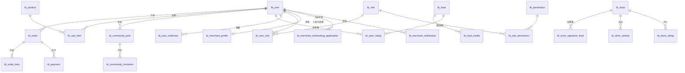

# 数据库设计

> 数据库:`feiyi_food_platform`(MySQL 8.0+,字符集 `utf8mb4`,全部 InnoDB)。
> 建表脚本与演示数据:建表脚本 [sql/feiyi_food_platform.sql](../sql/feiyi_food_platform.sql)(Navicat 导出,含 `SET FOREIGN_KEY_CHECKS=0`,未使用外键约束,关联关系由应用层维护)。
> 共 **31 张表**,全部以 `tb_` 为前缀。

## 1. 领域划分

| 领域 | 表 |
|---|---|
| 用户与权限 | `tb_user`、`tb_role`、`tb_user_role`、`tb_permission`、`tb_role_permission`、`tb_settings` |
| 非遗美食内容 | `tb_food`、`tb_food_media`、`tb_user_rating`、`tb_user_collection` |
| 店铺 | `tb_store`、`tb_store_signature_food`、`tb_store_activity`、`tb_store_rating` |
| 商城交易 | `tb_product`、`tb_cart_item`、`tb_order`、`tb_order_item`、`tb_payment` |
| 社区 | `tb_community_post`、`tb_community_comment` |
| 商家体系 | `tb_merchant_profile`、`tb_merchant_onboarding_application`、`tb_merchant_qualification_application`、`tb_merchant_product_submission`、`tb_merchant_content_submission`、`tb_merchant_review_audit`、`tb_merchant_sensitive_word`、`tb_merchant_settlement`、`tb_merchant_withdrawal`、`tb_merchant_artisan` |

## 2. 实体关系(核心链路)

## 3. 表结构明细

> 说明:所有表均有自增主键 `id`;类型列省略了统一的 `CHARACTER SET utf8mb4` 声明;`datetime` 默认当前时间的声明略去。枚举取值以"备注"列为准。

### 3.1 用户与权限

**tb_user — 用户**

| 字段 | 类型 | 备注 |
|---|---|---|
| nickname | varchar(50) | 昵称 |
| password | varchar(100) | 密码(演示版,前端注册时写默认值,后端未校验) |
| phone | varchar(20) | 手机号,登录标识 |
| gender | int | 0 未知 / 1 男 / 2 女 |
| region | varchar(100) | 地区 |
| taste_tags | varchar(255) | 口味标签(口味测试产出) |
| avatar | varchar(255) | 头像路径 |
| register_time | datetime | 注册时间 |
| status | int | 1 正常 / 0 禁用 |
| is_admin | int | 1 管理员 / 0 普通用户 |

**tb_role — 角色**:`role_name`、`role_key`、`description`、`status`(0 禁用/1 启用)

**tb_user_role — 用户-角色关联**:`user_id`、`role_id`

**tb_permission — 权限**:`permission_name`、`permission_key`(权限标识)、`resource_type`(menu/button/api)、`resource_url`、`parent_id`(支持树形)、`description`、`status`

**tb_role_permission — 角色-权限关联**:`role_id`、`permission_id`

**tb_settings — 系统参数**:`key`、`value`、`description`、`status`(1 启用/0 禁用)

### 3.2 非遗美食内容

**tb_food — 非遗美食**

| 字段 | 类型 | 备注 |
|---|---|---|
| name | varchar(100) | 美食名称 |
| region | varchar(100) | 地区 |
| taste | varchar(50) | 口味 |
| heritage_level | varchar(50) | 非遗等级 |
| history / ingredients / process | text | 历史 / 食材 / 工艺 |
| cover_image | varchar(255) | 封面图 |
| average_score | decimal(2,1) | 平均评分 |
| collection_count / view_count | int | 收藏数 / 浏览数 |

**tb_food_media — 美食媒体**:`food_id`、`type`(image/video)、`resource_path`、`sort`(越小越靠前)

**tb_user_rating — 美食评分**:`user_id`、`food_id`、`score`、`content`

**tb_user_collection — 收藏**:`user_id`、`collection_type`(food/store)、`object_id`(对应 `tb_food.id` 或 `tb_store.id`)

### 3.3 店铺

**tb_store — 店铺**:`name`、`address`、`longitude`/`latitude`(decimal(10,6),地图打点)、`contact`、`opening_hours`、`introduction`、`score`(decimal(2,1))

**tb_store_signature_food — 招牌菜**:`store_id`、`name`、`image`、`description`、`price`、`sort`

**tb_store_activity — 店铺活动**:`store_id`、`activity_type`、`activity_rule`、`start_time`、`end_time`、`status`(1 进行中/0 已结束)

**tb_store_rating — 店铺评价**:`store_id`、`user_id`、`score`(1-5 星)、`content`、`images`(逗号分隔)

### 3.4 商城交易

**tb_product — 商品**

| 字段 | 类型 | 备注 |
|---|---|---|
| name | varchar(255) | 商品名称 |
| description | text | 描述 |
| price / original_price | decimal(10,2) | 现价 / 原价 |
| cover_image | varchar(500) | 封面 |
| images | text | 多图,JSON 格式 |
| category | varchar(100) | 分类 |
| stock / sales_count | int | 库存 / 销量 |
| rating | decimal(3,1) | 评分 |
| status | tinyint | 1 上架 / 0 下架 |

**tb_cart_item — 购物车项**:`user_id`、`product_id`、`quantity`

**tb_order — 订单**:`order_no`、`user_id`、`total_amount`、`status`(**0 待支付 / 1 已支付 / 2 已发货 / 3 已完成 / 4 已取消**)、收货人三件套(`receiver_name/phone/address`)、`remark`

**tb_order_item — 订单明细**:`order_id`、`product_id`、`product_name`、`cover_image`(下单时快照)、`price`、`quantity`、`subtotal`

**tb_payment — 支付记录**:`order_id`、`payment_no`、`user_id`、`payment_method`、`payment_status`(**0 待支付 / 1 成功 / 2 失败**)、`transaction_id`、`amount`、`paid_at`

### 3.5 社区

**tb_community_post — 帖子**:`user_id`、`title`、`content`、`type`(**food 美食帖 / store 探店帖 / other 其他**)、`media_path`、`like_count`、`comment_count`

**tb_community_comment — 评论**:`post_id`、`user_id`、`content`

### 3.6 商家体系(10 张表)

> 商家域表结构由后端 `MerchantSchemaInitializer` 在启动时自动 `CREATE TABLE IF NOT EXISTS`,保证新环境可跑通;SQL 文件中同样包含这些表的建表与演示数据。

| 表 | 说明 | 关键字段 |
|---|---|---|
| tb_merchant_profile | 商家档案 | `store_name`、`store_status`、`commission_rate`、`heritage_certified`、`settlement_amount`、`withdraw_pending`、联系方式 |
| tb_merchant_onboarding_application | 入驻申请 | `applicant_name`、`phone`、`store_name`、`category`、`region`、`attachment_urls`、`status` |
| tb_merchant_qualification_application | 非遗资质认证申请 | `project_name`、`certificate_no`、`issuer`、`attachment_urls`、`status` |
| tb_merchant_product_submission | 商品提报(待审) | `product_name`、`category`、`price`、`heritage_tag`、`status` |
| tb_merchant_content_submission | 内容提报(待审) | `title`、`content_type`、`risk_point`(风险提示)、`status` |
| tb_merchant_review_audit | 评价审核 | `content`、`hit_words`(敏感词命中)、`status` |
| tb_merchant_sensitive_word | 敏感词库 | `word` |
| tb_merchant_settlement | 结算单 | `period`、`order_count`、`turnover`、`commission_amount`、`payable_amount`、`status` |
| tb_merchant_withdrawal | 提现申请 | `amount`、`account_name`、`account_no`、`status` |
| tb_merchant_artisan | 匠人认证 | `artisan_name`、`heritage_skill`、`level`、`verified`、`status` |

各申请/审核表的 `status` 均为 varchar 状态机(如 `pending / approved / rejected` 等,由应用层流转)。

## 4. 设计说明与注意事项

1. **无外键约束**:表间关联(如 `order_item.order_id → order.id`)由应用层保证,便于批量导入演示数据与后续分表演进。
2. **时间字段命名不统一**:交易域用 `created_at/updated_at`,其余多为 `create_time/update_time`,实体层已分别映射;二次开发时注意对应关系。
3. **快照设计**:`tb_order_item` 冗余了商品名/图片/单价,避免商品变更影响历史订单。
4. **收藏表复用**:`tb_user_collection` 通过 `collection_type + object_id` 同时支撑美食与店铺两类收藏。
5. **演示数据**:SQL 内含 559 条 INSERT(用户、美食、店铺、商品、帖子及商家全流程数据),演示账号见 [README 快速开始](../README.md)。
